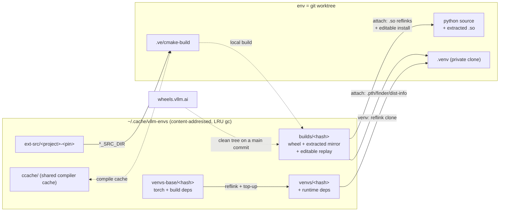

# vllm-envs (`ve`)

Fast disposable vLLM dev environments from any branch/commit, built on content-addressed layer caches. Spin up an agent workspace in seconds; hop commits (including `git bisect`) without re-paying dependency installs or CUDA builds.

## Install

```bash
uv tool install --editable /path/to/vllm-envs   # or: uv pip install -e .
```

Requires: `uv`, `ccache`, git ≥ 2.15. Reflink-capable filesystem (XFS/btrfs) recommended; falls back to plain copies otherwise.

## Usage

**Manage a clone in place** — build + deps assembled from cache into `./.venv`:

```bash
cd vllm                     # your vLLM clone
ve init
source .venv/bin/activate   # plain venv — always works
```

**New worktrees become envs automatically.** After `ve init` (or `ve new`) has run once in a repo, its worktree hook auto-initializes every new worktree:

```bash
git worktree add -b my-branch ../my-feature
cd ../my-feature && source .venv/bin/activate
```

Omit `-b` only when the branch already exists. If `VE_NO_AUTO_INIT=1`, the hook
skips environment creation and you must run `ve init` in the new worktree:

```bash
cd ../my-feature
ve init
source .venv/bin/activate
```

**Or spawn disposable envs by ref** (created under `~/vllm-envs/`):

```bash
ve new main                 # env from main
ve new v0.13.0 --name bisect1
```

Inside an env you can `git checkout <sha>` / `git bisect` / `git pull` freely — ve's git hooks (post-checkout, post-commit, post-merge, post-rewrite; installed wherever `core.hooksPath` points, chaining any existing hook) re-sync the layers when a hop changes requirements, build inputs or vLLM's extras installers. Rebases and merges in progress defer the sync until they finish; every bisect step syncs, since each is a commit you're about to test. `ve sync` refreshes the hooks after a `ve` upgrade. Optionally add `eval "$(ve shellenv)"` to your shell rc, then `ve activate` sources the venv from anywhere inside an env.

The first few environment setups can be slow while dependency and build caches
populate. Setup gets faster with continued use as more layers become cache hits.

**Everyday commands:**

| Command | What it does |
|---|---|
| `ve status` | layer hashes + cache state for the current env |
| `ve sync` | re-resolve layers for the current worktree HEAD |
| `ve list` | list live envs |
| `ve rm <name> [--force]` | remove a `ve new` env (refused if dirty/unpushed unless `--force`); `ve init`/auto-initialized checkouts are only unmanaged, never deleted |
| `ve reap` | list worktrees; reap stale ones (see below) |
| `ve gc [--dry-run]` | LRU cache pruning (100GB default cap, on physical usage) |
| `ve du` | disk audit: logical vs reflink-aware physical, per store/env |
| `ve precompiled [--json]` | which upstream wheel matches this worktree's compiled sources (read-only) |
| `ve rules [path] [--json]` | this worktree's vLLM-version facts and which [rules](#vllm-version-rules) fire (read-only) |
| `ve errors` | recurring warnings/errors from the local [incident log](#incident-log) |
| `ve drift [env]` | packages/files changed by hand in env venvs ([drift](#venv-drift)) |

## Worktrees

Auto-init fires on `git worktree add`, so every new worktree of a clone gets a
ready `.venv` from cache automatically. Install the hook once in your clone:

```bash
cd ~/local/vllm && ve init   # once; installs the worktree hook
```

Worktrees pile up. `ve reap` treats any linked worktree as stale once it has
been inactive for longer than a cutoff (30 days by default). Activity is the
latest of the HEAD commit time and the worktree's git HEAD, reflog, and index
updates, so checking out an old commit or staging changes keeps it alive.

```bash
ve reap                    # list every worktree: age, dirty count, push status,
                           #   and reap safety (stale ones first)
ve reap --stale            # remove all stale worktrees...
                           #   ...but only the clean AND pushed/merged ones
ve reap --older-than 14    # use a different cutoff for this run
ve reap <name>             # reap one by name or path
```

Reaping is gated: a worktree with uncommitted changes or un-pushed commits is
skipped (add `--force` to override, `--dry-run` to preview). Recently active
worktrees and the primary checkout are never touched without `--force`.
Worktrees whose directory is already gone are always safe to reap; that only
prunes git's record of them.

Prefix a single command with `VE_NO_AUTO_INIT=1` to skip auto-init. Avoid
exporting it globally; if it is already exported, use `VE_NO_AUTO_INIT=` to
enable auto-init for a worktree command.

## How it works

An env is just a git worktree plus a private `.venv`, assembled from shared content-addressed stores under `~/.cache/vllm-envs/`:

| Store | Contents | Keyed by |
|---|---|---|
| `venvs-base/` | torch + build deps | build requirements + torch pins + python/CUDA version |
| `venvs/` | full deps (derived from `venvs-base`); test deps too when `[venv] test` is on | base key + runtime (+ test) requirements |
| `ep-kernels/` | cached EP-kernel wheels and their NVSHMEM runtime | vLLM installer + Docker pin + venv/CUDA inputs |
| `ext-src/` | pinned external sources (cutlass, flash-attn, ...); elfutils headers for DeepGEMM when the host lacks `elfutils-devel` | project + pin parsed from the worktree's cmake files |
| `builds/` | compiled-extension wheel + extracted-file mirror + editable-install replay | source + Python/Torch ABI + host/compiler/CUDA/GPU target + build flags |



`ve sync` (run by `ve new`/`ve init` and the post-checkout hook) resolves four layers, skipping whatever is already consistent:

1. **venv** — requirements files are hashed; on a hit the env's `.venv` is reflink-cloned from the cached template (CoW: edit site-packages freely, other envs are unaffected). Templates are derived `venvs-base` → `venvs`, so a runtime-requirements change only re-installs the delta. On a commit hop the private venv is converged in place (top-up install + uninstall of dropped deps).
2. **build** — csrc/cmake/setup.py content (plus `rust/`, `rust-toolchain.toml`, `tools/build_rust.py` once a commit has the Rust frontend) is hashed together with the effective Python/Torch ABI, host/compiler/CUDA toolchains, GPU target, and build flags. Clean-tree resolution order: store hit → [precompiled wheel](#precompiled-wheels) from wheels.vllm.ai with identical compiled sources (published into the store) → local build (also published), with `ext-src/` pins injected via `*_SRC_DIR` env vars. Each worktree builds in its own `.ve/cmake-build`, so retries and commit hops are incremental and no build tree is ever shared between worktrees (CMake pins a tree to its source directory). Sharing happens in the compiler cache instead: `ve` runs ccache with its own directory (`~/.cache/vllm-envs/ccache`, `[cache] ccache_max_size_gb`, default 100) and `CCACHE_BASEDIR=<worktree>`, so an unchanged translation unit hashes the same in every worktree (a second worktree's `_moe_C` build: 29/30 cache hits, 28s vs 119s cold). Only build-relevant environment variables (an explicit allowlist: compiler flags, `CMAKE_ARGS`, `TORCH_CUDA_ARCH_LIST`, ...) and the set of GPU models enter the build key, so GPU reservations and runtime knobs don't split the cache. Dirty csrc/ or user `*_SRC_DIR` overrides → private builds, never published.
3. **attach** — makes the worktree importable as an editable install: the wheel's `.so` files and bundled third-party py files are placed into the worktree as reflinks of the shared mirror in `builds/<hash>/extracted/` (~450MB physical shared per env), and the editable-install artifacts (`.pth`, finder, dist-info) are written into the venv. The first attach at a build hash runs vLLM's own setup.py once (historically correct extraction for old releases) and captures the result; later attaches at the same commit replay it with no setup.py run, and an already-attached env is a no-op.
4. **vLLM extras** — installs vLLM's supported optional runtime bundle as one unit. The bundle uses the checkout's own EP-kernel and KV-connector installers, so compatible DeepEP, NVSHMEM, NIXL, Mooncake, and related components move together with the vLLM commit.

Warm-cache timing: fresh `ve new`/`ve init` ~7s, no-op `ve sync` ~1s; a cold build costs one normal vLLM build, then every env at that hash shares it.

### Precompiled wheels

A wheel from wheels.vllm.ai is reused when its commit has exactly the same *compiled sources* as the worktree HEAD. The path set is vLLM's own `WHEEL_BLOCKING_PATHS` (read from the worktree's `setup.py` without executing it; default `csrc cmake CMakeLists.txt pyproject.toml vllm/_custom_ops.py` for older commits). A commit's identity is the git object id of each of those paths (absent paths count as "missing"; `pyproject.toml` counts without its `[tool.*]` lint config), computed for HEAD plus first-parent `origin/main` from the tip to 300 commits before the merge-base in one `git cat-file` call. Matching main commits form a contiguous run that often extends *past* the merge-base, so candidates are HEAD first (release branches publish exact-commit wheels), then matches nearest the merge-base in either direction. Up to 32 are probed, HEAD first and then 8 at a time in parallel (publication has gaps: one outage left 18 consecutive main commits without wheels), in the CUDA variant directory only (`cu129`/`cu130`; like vLLM, the root wheel is never used). vLLM's warning paths (`setup.py`, `rust`) never block a match; a differing one is mentioned in the fetch log. Any uncommitted change under the path set disables the lookup.

Results are remembered in `<cache>/precompiled-index.json`: identity + variant + arch → wheel (permanent), and unpublished commits for 1h (publication lags main by a few commits). The build entry's meta records the source commit, and `ve status` prints a `kernels:` line saying where it sits relative to the worktree's merge-base. `ve precompiled` shows the path set, identity, matching main run, probes and chosen wheel without downloading or writing anything.

## Config

`~/.cache/vllm-envs/config.toml`:

```toml
[cache]
max_size_gb = 100      # VE_MAX_SIZE_GB overrides; enforced on reflink-aware physical usage
min_age_hours = 72
ccache_max_size_gb = 100  # ve's compiler cache; VE_CCACHE_MAX_SIZE_GB overrides
                          #   (a CCACHE_DIR you export yourself wins over ve's)

[core]
envs_root = "~/vllm-envs"   # VE_ENVS_ROOT overrides
python = "3.12"

[venv]
cap = "minor"   # cap unpinned requirement floors: minor | major | none (VE_CAP overrides)
test = true     # install & cache requirements/test/<platform>.txt into the full venv
                #   (prefers the pinned .txt, falls back to .in); VE_WITH_TEST overrides
vllm_extras = true  # install the vLLM extras bundle; VE_WITH_VLLM_EXTRAS overrides
allow_local_build = true  # false: fail instead of compiling when no wheel matches;
                          #   VE_ALLOW_LOCAL_BUILD overrides

[reap]
max_age_days = 30   # `ve reap`: worktrees inactive longer are stale;
                    #   VE_REAP_MAX_AGE_DAYS or `--older-than` override
```

Values are validated: booleans accept `true/false/yes/no/on/off/1/0` (from
TOML or the environment), unknown keys are warned about, and an invalid value
stops `ve` with a one-line error naming the key.

With `test = true` (the default) the `venvs/` layer also installs vLLM's test
dependencies (`pytest`, `lm-eval`, ...), cached and reflink-shared like the rest;
set `test = false` (or `VE_WITH_TEST=0`) to keep envs lean.

When a CUDA vLLM checkout requires `flashinfer-python`, `ve` also installs the
matching `flashinfer-jit-cache` wheel from FlashInfer's CUDA-specific index
(rule `flashinfer-jit-cache`) and, from flashinfer 0.6.14, the matching
`flashinfer-cubin` (rule `flashinfer-cubin`), mirroring what
`flashinfer download-kernels` does in vLLM's image. These derived
dependencies have no opt-out.

CUDA environments install the vLLM extras bundle by default using the
checkout's `tools/ep_kernels/install_python_libraries.sh` and
`.buildkite/scripts/install-kv-connectors.sh`. Pins and requirements therefore
follow the selected vLLM commit. Set `vllm_extras = false` (or
`VE_WITH_VLLM_EXTRAS=0`) to opt out. Unsupported components are skipped for
older commits. CUDA architectures include the vLLM Docker targets and locally
detected GPU targets unless `TORCH_CUDA_ARCH_LIST` is explicitly set.

Env vars: `VE_CACHE_DIR`, `VE_NO_SYNC=1` (skip hook sync, warn instead),
`VE_NO_ERROR_LOG=1` (don't record incidents).

## vLLM version rules

Everything `ve` does differently for some vLLM commits lives in two places:

- `vllm_envs/treefacts.py` — **facts**: named, lazily computed probes of the
  worktree's files (which requirements files exist, newest layout era
  first; EP installer and its DeepEP/NVSHMEM/
  pplx pins, `docker/versions.json` NCCL pin, KV installer, Rust frontend,
  setup.py wheel path sets, ...). Each `@fact` records its detector, the
  upstream commit/PR that introduced what it detects, and what it gates. One
  `TreeFacts` is shared by all consumers during a sync, so e.g. the DeepEP
  layer and the extras bundle key can no longer disagree on "DeepEP supported".
- `vllm_envs/workarounds.py` — **rules**: one table, `RULES`, of
  `Rule(id, rev, reason, when=(...), then=(...))`, evaluated by
  `vllm_envs/rules.py`. All `when` predicates must hold: `Req(name, spec)`
  (declared in the requirement files being hashed/installed; spec `""`,
  `">=X"` or `"<X"` on the declared minimum), `Platform`, and
  `Fact(name[, value])`. Effects: `AddReq`, `OverrideReq`, `ExtraIndex`,
  `DerivedInstall` and `PatchSource`.

A rule that fires contributes `rule:<id>@<rev>` to the cache key of each
layer it changes (`venv-base`/`venv-full`, `ep`, `kv`), so bumping `rev`
invalidates exactly what the rule affects; rules that do not fire leave keys
alone.

To add "commits after X need Y":

1. Find a content signal for X (a file, a pinned version, a setup.py constant)
   — `git -C ~/local/vllm log --diff-filter=A -- <path>` or `-S<text>` finds
   the introducing commit. Add a `@fact` if no predicate expresses it.
2. Add a `Rule` to `workarounds.py` citing the commit/PR in `reason`, with `rev=1`, and the
   consumer reads it via `rules.effects(ctx, <EffectType>, layer)`.
3. Add a synthetic test in `tests/test_rules.py` and a row to
   `BOUNDARIES` in `tests/test_boundaries.py` asserting the value at the
   commit's parent and at the commit (runs against a local vLLM clone,
   `VE_VLLM_REPO`, default `~/local/vllm`; skipped without it).

`ve rules [path] [--json]` prints the facts (with their origin), the rules
that fire with their reasons and affected keys, and the rules that do not.
`ve status` lists the fired rules.

## Incident log

Every `ve` warning and error is appended to `$VE_CACHE_DIR/errors.jsonl`,
including failures inside git hooks, fallbacks such as a failed local build,
and unhandled exceptions. Each record holds the command, repo and HEAD, `ve`
version, the agent session when run by Claude Code or Codex, the traceback,
and the failed subprocess's output: an error excerpt (ninja `FAILED:` blocks
narrowed to their errors), the tail, and the full output gzipped under
`$VE_CACHE_DIR/incident-logs/` (latest 50). Records share a fingerprint
when they differ only by paths, hashes, or numbers, so recurring problems
group together.

```bash
ve errors                      # recurring incidents, most frequent first
ve errors list                 # individual incidents, newest last
ve errors show <id|fingerprint> [-t]   # details, error excerpt, notes (-t: traceback)
ve errors show <id> --full     # complete output of the failed command
ve errors note "<what you did>" [--ref <id|fingerprint>]
```

`ve errors note` records how an incident was handled or worked around. Without
`--ref` it attaches to the latest error in the current repo, or the latest
warning if there is no error. All subcommands accept `--json`.

## Venv drift

Agents that hit a broken env tend to repair it themselves: `pip install` a
missing package, pin a different version, uninstall something, or patch a file
in site-packages. That is not an error, but it shows where `ve` set the env up
wrong. After every sync `ve` saves the package set it left in
`.ve/synced-freeze.txt`. Its own later installs are folded in, so only
hand-made changes show up as drift:

```bash
ve drift                # table of drifted envs (all registered envs)
ve drift <env|path|.>   # added/changed/reinstalled/removed packages, patched files
ve drift --record       # also log current drift to the incident log
```

`ve sync`, `ve reap`, and `ve rm` record new drift in the incident log
(level `drift`, grouped by which packages were touched), so it survives the
worktree; `ve errors --level drift` lists it. `ve status` shows a one-line
drift summary. Envs last synced before drift tracking existed are marked
`*`: for them drift means packages and files modified after their last sync,
plus template packages that are missing.

## Tests

The default suite is fast and replaces only external builds and installs:

```bash
python -m unittest discover -s tests -v
```

An opt-in E2E mode runs real `uv` installs, vLLM/CUDA compilation, vLLM extras
build and import, Git hooks, worktree creation, a committed build-input edit,
and checkout back to the original cached build:

```bash
VE_REAL_E2E=1 \
VE_REAL_E2E_REPO=~/local/vllm \
VE_REAL_E2E_CACHE_DIR=~/.cache/vllm-envs-e2e \
python -m unittest -v tests.test_real_e2e
```

`VE_REAL_E2E_CACHE_DIR` is optional. Without it the test uses and removes an
isolated cold cache; setting it keeps the expensive layers for subsequent
cache-hit runs. Select another commit with `VE_REAL_E2E_REF`; set
`VE_REAL_E2E_WITH_TEST=0` to omit vLLM's test requirements. Real E2E requires
an NVIDIA host and is skipped unless explicitly enabled.

## Caveats (v1)

- Requirements top-up on commit hop converges the env venv (installs the delta, uninstalls deps dropped from the template resolution); user-added packages survive, but for a guaranteed-clean venv use `ve sync --fresh-venv`.
- The upstream precompiled-wheel fallback (`VLLM_USE_PRECOMPILED`) is used when a local build fails; those artifacts are not captured into the store.
- DeepEP's Gin backend needs the NCCL vLLM's image pins (`NCCL_VERSION` in `docker/versions.json`), not the older one torch requires exactly. ve mirrors `docker/Dockerfile` and passes `UV_OVERRIDE` to the EP installer so the pin survives the installer's own `uv pip install torch`, and additionally puts the NCCL wheel's lib dir on `LIBRARY_PATH` — DeepEP links `-l:libnccl.so.2` without adding that directory, which only works when NCCL sits on the default search path (true in the image, not in a venv).
- vLLM's compiled test lock periodically goes stale against its runtime requirements (e.g. `requirements/test/cuda.txt` pinning `cuda-pathfinder==1.3.3` while the pinned `flashinfer-python` needs `>=1.5.4`). Upstream installs those files in separate passes, so they never have to agree; when a combined resolve fails, ve does the same — test lock first, runtime last, so the runtime pins win where they overlap — and warns. This and the cap fallback below only trigger when uv cannot *resolve* the set (checked with a dry run); a download or build failure of a resolvable set is reported as an error. The template's `meta.json` records the cap mode and whether passes were split.
- Unpinned requirement floors (e.g. `transformers>=4.5`) are capped near their era at resolve time: by default each floored-but-uncapped requirement gets an upper bound at the next minor (`>=4.5` → `<4.6`); `cap = "major"` bounds at the next major, `"none"` restores resolve-to-latest. When the caps are mutually unsatisfiable (stale floors), ve automatically falls back minor → major → none with a warning. The cap mode folds into the venv template key.
